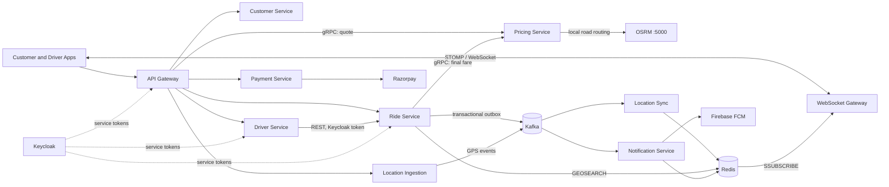
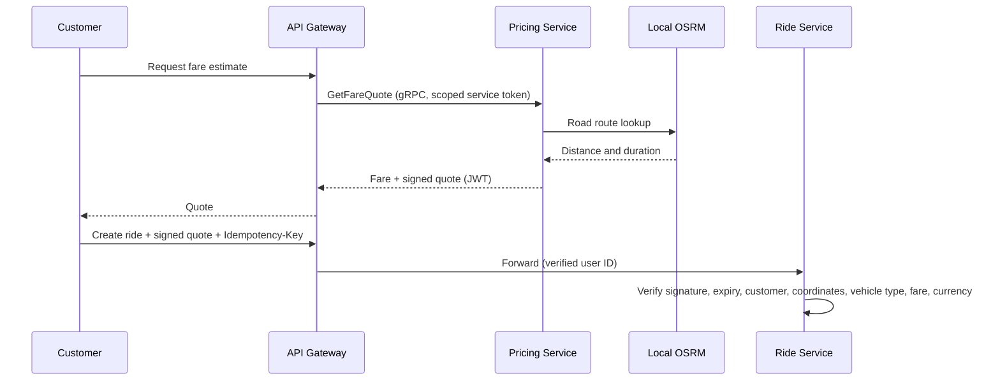
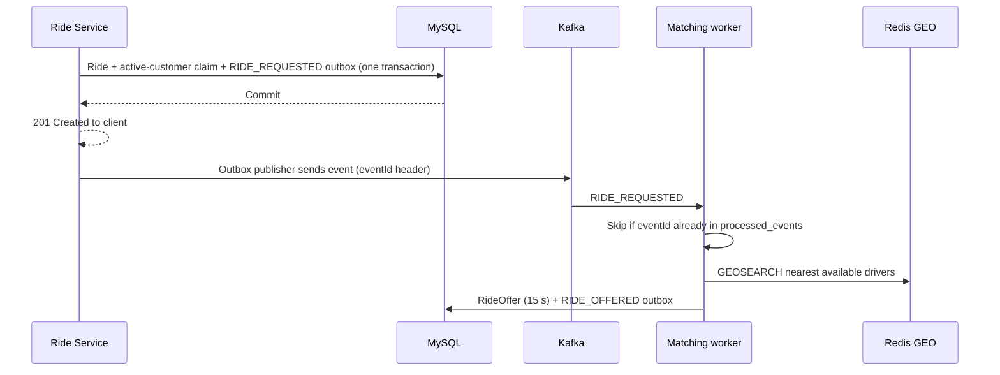
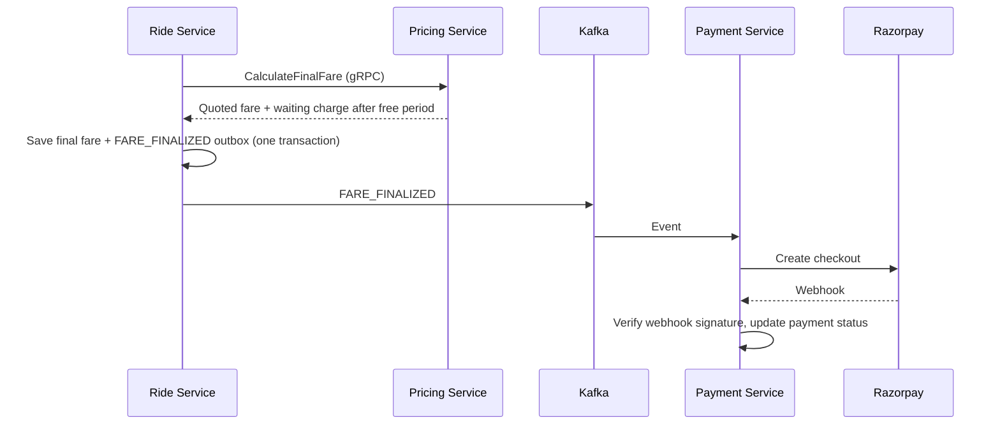

# GoOn | Ride-hailing platform

GoOn is a distributed ride-hailing backend built as ten independently deployable Spring Boot services. Its core engineering challenge is keeping state correct across a synchronous booking flow, asynchronous location streams, competing driver actions and external payment callbacks.

**Stack:** Java · Spring Boot 4.1 · Spring Cloud Gateway (Server Web MVC) · gRPC · Kafka · Redis (GEO, sharded Pub/Sub) · MySQL · Keycloak (OAuth2) · OSRM · Razorpay · Docker · JMeter

[System HLD (Excalidraw)](https://excalidraw.com/#json=D2atq182zMWkLQBuF3ELN,7Ad97etRNaexRR1o91NAdg) · [Validation plans and evidence](benchmarks/RESULTS.md)

<!-- TODO: add demo GIF/video once recorded (book -> offer -> accept -> live tracking):
 -->

## Contents

1. [What the system does](#what-the-system-does)
2. [Architecture](#architecture)
3. [Engineering decisions](#engineering-decisions)
4. [Measured validation](#measured-validation)
5. [Known limitations](#known-limitations)
6. [Services](#services)
7. [Local development](#local-development)
8. [Reproducing the tests](#reproducing-the-tests)

## What the system does

- Prices trips from road distance using a **locally hosted OSRM** instance and returns a **signed quote**.
- Creates rides with **idempotency** and **database-enforced active-ride claims**.
- Matches a request to the nearest available driver from Redis GEO data, offering to one driver at a time for 15 seconds.
- Streams driver locations through Kafka, Redis sharded Pub/Sub and STOMP/WebSocket.
- Tracks ride transitions, sends notifications (FCM push and in-app WebSocket) and collects payment through Razorpay checkout with verified webhooks.
- Secures internal calls with **Keycloak OAuth2 client-credentials** tokens and scoped authorization on REST and gRPC.

## Architecture



### Location pipeline

GPS intake is asynchronous: Location Ingestion validates and publishes events, and Location Sync updates Redis. Idle locations are keyed by `driverId` on `driver-locations`; ride locations are keyed by `rideId` on `location-updates`. Keying preserves ordering per entity. It also means adding partitions cannot spread a single hot key across consumers.

Ride Service uses `GEOSEARCH` to find available drivers within 5 km, nearest first. During a trip, ride-specific GPS points go over Redis sharded Pub/Sub and are relayed to both apps by the WebSocket Gateway. Notification Service publishes driver offers on a separate channel and sends FCM pushes.

### Signed quote flow



The signed quote means a client cannot alter protected quote fields without invalidating the signature. Fares use `BigDecimal` (INR); coordinates use `double`.

### Booking and ride lifecycle



States progress `REQUESTED → ASSIGNED → DRIVER_ARRIVED → STARTED → ENDED`; cancellation is supported before start. Every state change and its outbox event commit in one database transaction.

### Fare finalization and payment



## Engineering decisions

| Problem | Mechanism | Why it matters |
|---|---|---|
| Two requests booking for one customer | `customer_active_rides` claim: `customer_id BINARY(16)` primary key, inserted with the Ride and Outbox rows | The database arbitrates concurrent requests; an application-level "check then insert" can race. |
| One driver accepting two rides | Unique driver-assignment claim, with Ride locked before RideOffer | Competing accepts serialize on the driver claim; a fixed lock order removes the lock cycle. |
| Concurrent accept vs decline on one offer | `SELECT ... FOR UPDATE` on the Ride row, then state check | Exactly one terminal action wins; losers receive `409`. |
| Client retries after a timeout | Unique customer + idempotency key, plus request hash | Same request returns the original ride; reusing a key with a different payload returns `409`. |
| Ride saved but event lost | Transactional outbox and event-ID-aware consumers (`processed_events`) | State and event commit together; at-least-once delivery with deduplicated effects. |
| Token stampede on Keycloak | In-memory M2M token cache per scope set with single-flight refresh | Under load, hundreds of threads once requested tokens at the same moment and exhausted the HTTP/2 stream limit. Now one thread fetches and the rest reuse the result. |
| Stale or distant arrival ping | Freshness check plus Haversine distance against the ride-specific Redis location | Arrival requires the assigned driver's recent position within 100 m of pickup. |
| UUID lookup mismatch | MySQL UUID columns and Hibernate mappings standardized on `BINARY(16)` | Prevents 16-byte UUID parameters from failing to match padded values. |

Arrival geofence: `φ` and `λ` are latitude and longitude in radians.

$$
a = \sin^2(\Delta\varphi / 2) + \cos(\varphi_1)\cos(\varphi_2)\sin^2(\Delta\lambda / 2)
$$

$$
d = 2R \times \operatorname{atan2}(\sqrt{a}, \sqrt{1-a}), \qquad R \approx 6{,}371{,}000\text{ m}
$$

The matching radius is 5 km; the arrival geofence is 100 m. They serve different stages of the ride.

## Measured validation

All runs are **local development runs on one laptop** (HP Pavilion 14, Intel i5-1135G7, 16 GiB RAM), not production capacity claims.
Environment: JDK 23.0.1 · Spring Boot 4.1.1 · MySQL 9.1.0 · Redis 7.4.10 · Kafka 3.7.1 · JMeter 5.6.3.
JMeter plans, redacted JTL files, SQL checks and raw summaries are in [`benchmarks/`](benchmarks/RESULTS.md). Git revisions are recorded in the evidence bundle.

<!-- TODO before publishing: commit the API Gateway changes (InternalOAuth2ClientConfig, application.yaml, ServiceTokenRelayFilterFunctions) and record the final revision hashes. -->

### Correctness under concurrency

| Scenario | Result |
|---|---|
| Same customer, two simultaneous creates with different keys | 1 × `201`, 1 × `409`; one ride, one active claim, one outbox event |
| Same-key create retry | 200 concurrent requests returned `201`; one ride and one `RIDE_REQUESTED` event. (Throughput of this burst is not a performance figure.) |
| Accept vs decline on one offer | 20 rides × 50 simultaneous requests (25 accepts + 25 declines): 10 × `200`, 10 × `204`, 980 × `409`, 0 × `500`. Each ride had exactly one winner: 10 ended `ASSIGNED` with one `ACCEPTED` offer and one `DRIVER_ASSIGNED` event; 10 stayed `REQUESTED` with no accepted offer. JMeter reports 98% "errors" because it counts the expected `409`s. |
| One driver, two rides | 10 simultaneous pairs; exactly one accept succeeded and one conflicted in every pair |
| Lock-order deadlock | Two opposing manual MySQL transactions (Ride then Offer vs Offer then Ride) produced error 1213 and an InnoDB lock-cycle report. This is a **database-level demonstration**, not a reproduction through the application path. Services lock Ride before RideOffer. |

### Failure injection

| Scenario | Result |
|---|---|
| `kill -9` RideService during ride creation (20 threads × 10 loops) | 194 × `201`, 6 × `500` for requests in flight during the kill. 194 rides and 194 `RIDE_REQUESTED` outbox rows, all `PUBLISHED`, 0 pending after 60 s; at most one offer per ride. Run is partial because of the six `500`s. |
| Replay of a published event with the same `eventId` | `processed_events` stayed at 1 and offers stayed at 1 |

### Throughput and scaling (GPS ingestion over HTTP, 2 s pacing)

| Run | Threads | Req/s | p50 / p95 / p99 (ms) | Errors |
|---|---:|---:|---|---|
| 1 ingestion instance, 20 driver IDs | 100 | 48.62 | 6 / 23 / 89 | 0% |
| 1 ingestion instance, 20 driver IDs | 250 | 118.75 | 8 / 249 / 600 | 0% |
| 1 ingestion instance, 20 driver IDs | 500 | 221.33 | 40 / 1,212 / 1,637 | 0% |
| 3 ingestion replicas behind Spring Cloud Gateway | <!-- TODO: threads --> | 327 | p95 180 | 0% |

- The 500-thread single-instance run reached 100% CPU. Kafka lag was 1,006 right after the run and 0 after the drain wait. Records advanced on all three `driver-locations` partitions (2,559 / 7,042 / 3,200).
- The 3-replica setup: three Docker ingestion containers, round-robin through Spring Cloud LoadBalancer with a static instance list, three Kafka partitions and Location Sync consumers across them.
- The reported configuration changed both replication **and** Kafka publishing. The improvement cannot be attributed to either one alone without a controlled experiment.
- These figures measure HTTP ingestion, not end-to-end WebSocket delivery.

## Known limitations

- Single-node, local runs only. No multi-host, network-partition or chaos testing.
- The six `500` responses during the forced kill are not yet mapped to a retryable status; clients must retry with the same Idempotency-Key.
- Deadlock handling is verified at database level, not via the application path.
- The scaling run changed two things at once (see above).
- Keycloak token caching was verified functionally; no before/after token-request counts were recorded.
- Redis replica/leader failover has not been validated.
- OTP storage, no-driver-found retry behaviour and long-lived user JWT policy are open hardening items.

## Services

| Service | Responsibility | Source |
|---|---|---|
| API Gateway | HTTP routing, user JWT authentication, quote gRPC call | [Repository](https://github.com/shashank35i/Api-Gateway-Service) |
| Customer Service | Customer accounts | [Repository](https://github.com/shashank35i/Customer-Service) |
| Driver Service | Driver APIs and offer actions | [Repository](https://github.com/shashank35i/Driver-Service) |
| Ride Service | Booking, matching, ride lifecycle and outbox | [Repository](https://github.com/shashank35i/Ride-Service) |
| Pricing Service | Signed quotes and final fare | [Repository](https://github.com/shashank35i/Pricing-Service) |
| Location Ingestion | GPS HTTP intake and Kafka publishing | [Repository](https://github.com/shashank35i/location-ingestion-service) |
| Location Sync | Kafka consumers and Redis location state | [Repository](https://github.com/shashank35i/location-sync-service) |
| Notification Service | Redis notifications and Firebase push | [Repository](https://github.com/shashank35i/Notification-Service) |
| Payment Service | Checkout and webhook handling | [Repository](https://github.com/shashank35i/Payment-Service) |
| WebSocket Gateway | Live ride updates over STOMP/WebSocket | [Repository](https://github.com/shashank35i/ws-gateway-service) |

## Local development

Each service is a separate Maven project. <!-- TODO: confirm Java target in each pom.xml / Dockerfile; validation was run on JDK 23.0.1. -->

Prerequisites: MySQL, Kafka, Redis, Keycloak and a local OSRM server with a Hyderabad extract (coordinates must stay within lon 77.441 to 79.516, lat 16.707 to 18.095). Pricing reads `app.osrm.url: http://localhost:5000`; the public OSRM demo server is not used.

<!-- TODO: add docker-compose.yml for infrastructure and a one-command start. -->

```bash
cd ride-service
./mvnw spring-boot:run
```

On Windows, use `mvnw.cmd`.

| Component | Port |
|---|---:|
| API Gateway | 8087 |
| Customer / Driver / Ride | 8088 / 8084 / 8083 |
| Pricing HTTP / gRPC | 8086 / 9090 |
| Location Ingestion / Sync | 8080 / 8081 |
| Notification / Payment | 8085 / 8089 |
| WebSocket Gateway | 8082 |
| Keycloak | 8090 |
| Local OSRM | 5000 |

## Reproducing the tests

JMeter plans live in `benchmarks/`. Run in non-GUI mode:

```bash
jmeter -n -t benchmarks/<plan>.jmx -l results.jtl -e -o report/
```

SQL checks for each scenario (ride, outbox and offer counts per ride) are stored beside the plans and described in [`benchmarks/RESULTS.md`](benchmarks/RESULTS.md). Redact JWTs, secrets and OTPs before sharing results.
