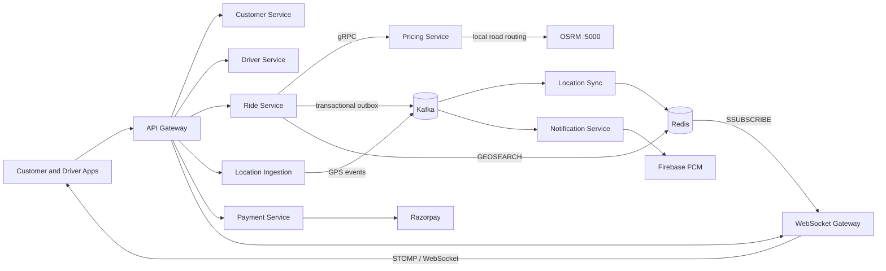
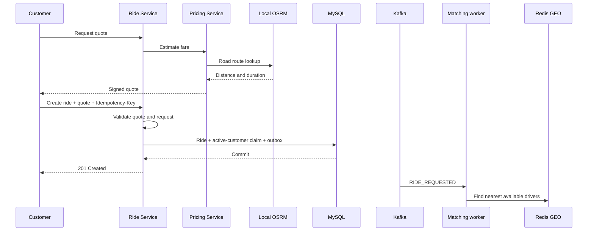

# GoOn | Ride-hailing platform

GoOn is a distributed ride-hailing backend built as ten independently deployable Spring Boot services. Its core engineering challenge is coordinating state that spans a synchronous booking flow, asynchronous location streams, competing driver actions, and external payment callbacks.

[System HLD · Excalidraw](https://excalidraw.com/#json=LZ0dhA7Fv0mq9qvbU2c6d,oJ580YLlsaPw_cdPOC5HAg) · [Validation plans and evidence](benchmarks/RESULTS.md)

## What the system does

- Prices trips using road distance from a locally hosted OSRM instance and returns a signed quote.
- Creates rides with idempotency and database-enforced active-ride claims.
- Matches a request to the nearest available driver from Redis GEO data.
- Streams driver locations through Kafka, Redis sharded Pub/Sub, and STOMP/WebSocket.
- Tracks ride transitions, sends notifications, and collects payment through Razorpay checkout and verified webhooks.

## Architecture



### Location pipeline

GPS intake is asynchronous: Location Ingestion validates and publishes events, while Location Sync updates Redis. Idle locations are keyed by `driverId` on `driver-locations`; ride locations are keyed by `rideId` on `location-updates`. This preserves ordering for each entity. It also means adding partitions cannot spread a single hot key across consumers.

Ride Service uses `GEOSEARCH` to find available drivers within 5 km, nearest first. During an active trip, ride-specific GPS points are sent over Redis sharded Pub/Sub and relayed to both apps by the WebSocket Gateway. Notification Service publishes driver offers on a separate channel and sends FCM push notifications.

### Booking and ride lifecycle



Ride states progress through `REQUESTED → ASSIGNED → DRIVER_ARRIVED → STARTED → ENDED`; cancellation is supported before start. Each state change and its outbox event commit in the same database transaction.

## Engineering decisions

| Problem | Mechanism | Why it matters |
|---|---|---|
| Two requests booking for one customer | `customer_active_rides` claim: `customer_id BINARY(16)` primary key, inserted with Ride and Outbox | The database arbitrates concurrent requests; an application-level “check then insert” can race. |
| One driver accepting two rides | Unique driver assignment claim, with Ride locked before RideOffer | Competing accepts serialize on the driver claim; a consistent lock order reduces deadlock risk. |
| Client retries after a timeout | Unique customer + idempotency key and request hash | Same request returns the original ride; reusing a key with a different payload returns `409`. |
| Ride saved but event lost | Transactional outbox and event-ID-aware consumers | Business state and the event record commit together; delivery can be retried without repeating the business effect where deduplication is implemented. |
| Stale or distant arrival ping | Freshness check plus Haversine distance against ride-specific Redis location | Arrival requires the assigned driver's recent position to be within 100 m of pickup. |
| UUID lookup mismatch | Standardized MySQL UUID columns and Hibernate mappings on `BINARY(16)` | Prevents 16-byte UUID parameters from failing to match padded `BINARY(64)` values. |

For arrival, `φ` and `λ` are latitude and longitude in radians:

$$
a = \sin^2(\Delta\varphi / 2) + \cos(\varphi_1)\cos(\varphi_2)\sin^2(\Delta\lambda / 2)
$$

$$
d = 2R \times atan2(\sqrt{a}, \sqrt{1-a}), \qquad R \approx 6,371,000\text{ m}
$$

The matching radius is 5 km; the arrival geofence is 100 m. They serve different stages of the ride flow.

## Measured validation

JMeter plans, redacted JTL files, SQL checks, and raw result summaries are in [`benchmarks/`](benchmarks/RESULTS.md). These are local development runs, not production capacity claims.

| Scenario | Result |
|---|---|
| Same customer, two simultaneous creates with different keys | 1 × `201`, 1 × `409`; one ride, one active claim, one outbox event |
| One driver, two rides | 10 simultaneous pairs; one accept succeeded and one conflicted in every pair |
| Same-key create retry | 200 concurrent requests returned `201`; one ride and one `RIDE_REQUESTED` event |
| GPS ingestion, 500 threads | 221.33 requests/sec, p95 1,212 ms, 0% request errors across 20 driver IDs; Kafka lag drained to zero after traffic stopped |
| Outbox process-kill run | 194 acknowledged creates were published; replay created no second offer. Six in-flight requests returned `500`, so the run was partial. |

The 500-thread run peaked at 100% CPU on the test machine. See the evidence bundle for per-level latency, lag, resource readings, and test limitations.

## Fare and payment flow

Pricing Service uses the local OSRM endpoint configured as `app.osrm.url: http://localhost:5000`; it does not use the public OSRM demo server. Ride Service validates the signed quote before creating a ride. At trip completion, Ride Service requests final fare, saves it with a `FARE_FINALIZED` outbox event, and Payment Service creates a Razorpay checkout. Payment status changes after webhook signature verification.

## Services

| Service | Responsibility | Source |
|---|---|---|
| API Gateway | HTTP routing and request authentication | [Repository](https://github.com/shashank35i/Api-Gateway-Service) |
| Customer Service | Customer accounts | [Repository](https://github.com/shashank35i/Customer-Service) |
| Driver Service | Driver APIs and offer actions | [Repository](https://github.com/shashank35i/Driver-Service) |
| Ride Service | Booking, matching, ride lifecycle, and outbox | [Repository](https://github.com/shashank35i/Ride-Service) |
| Pricing Service | Signed quotes and final fare | [Repository](https://github.com/shashank35i/Pricing-Service) |
| Location Ingestion | GPS HTTP intake and Kafka publishing | [Repository](https://github.com/shashank35i/location-ingestion-service) |
| Location Sync | Kafka consumers and Redis location state | [Repository](https://github.com/shashank35i/location-sync-service) |
| Notification Service | Redis notifications and Firebase push | [Repository](https://github.com/shashank35i/Notification-Service) |
| Payment Service | Checkout and payment webhook handling | [Repository](https://github.com/shashank35i/Payment-Service) |
| WebSocket Gateway | Live ride updates over STOMP/WebSocket | [Repository](https://github.com/shashank35i/ws-gateway-service) |

## Local development

Each service is a separate Maven project targeting Java 21. Start MySQL, Kafka, Redis, Keycloak, and OSRM, then run an individual service:

```bash
cd ride-service
./mvnw spring-boot:run
```

On Windows, use `mvnw.cmd`.

| Component | Port |
|---|---:|
| API Gateway | 8087 |
| Customer / Driver / Ride | 8088 / 8084 / 8083 |
| Pricing HTTP / gRPC | 8086 / 9090 |
| Location Ingestion / Sync | 8080 / 8081 |
| Notification / Payment | 8085 / 8089 |
| WebSocket Gateway | 8082 |
| Local OSRM | 5000 |
