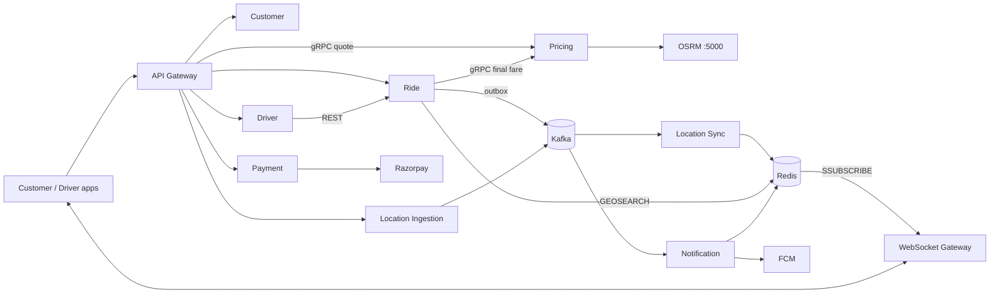
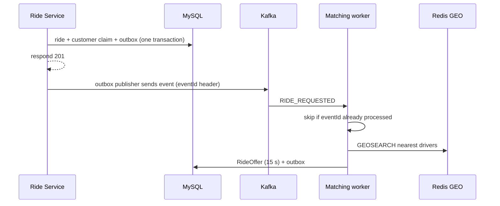

# GoOn

A ride-hailing backend I built as ten Spring Boot services. The interesting part is keeping state correct when bookings, driver actions, GPS streams and payment callbacks all happen at once.

Java, Spring Boot 4.1, Spring Cloud Gateway (MVC), gRPC, Kafka, Redis, MySQL, Keycloak, OSRM, Razorpay, Docker, JMeter.

[System diagram (Excalidraw)](https://excalidraw.com/#json=D2atq182zMWkLQBuF3ELN,7Ad97etRNaexRR1o91NAdg) · [Test plans and evidence](benchmarks/RESULTS.md)

<!-- TODO: demo GIF (book, offer, accept, live tracking) -->

## What it does

- Quotes a fare from road distance (self-hosted OSRM) and signs the quote.
- Creates rides idempotently, one active ride per customer.
- Finds the nearest free driver with Redis GEO and offers the ride to one driver at a time (15 s each).
- Streams driver location over Kafka, Redis sharded Pub/Sub and STOMP/WebSocket.
- Handles arrive, OTP start, end, final fare, Razorpay checkout and webhooks.
- Service-to-service calls use Keycloak client-credentials tokens with scopes.

## Architecture



**Booking.** The gateway asks Pricing for a quote over gRPC and gets back a signed JWT. When the customer books, Ride Service checks the signature, expiry, customer, coordinates, vehicle type, fare and currency. It then writes the ride, an active-customer claim and a `RIDE_REQUESTED` outbox row in one transaction.



Ride states: `REQUESTED → ASSIGNED → DRIVER_ARRIVED → STARTED → ENDED`. Cancellation is allowed before start. Each state change and its outbox event commit together.

**Location.** Ingestion validates pings and publishes to Kafka. Idle drivers use `driver-locations` keyed by `driverId`; drivers on a trip use `location-updates` keyed by `rideId`. Keys keep per-entity ordering, but they also mean extra partitions can't split one hot key. Location Sync writes to Redis and publishes with `SPUBLISH`.

**Payment.** On ride end, Ride Service asks Pricing for the final fare (quote plus waiting charge after the free period), stores it with a `FARE_FINALIZED` outbox row, and Payment Service creates a Razorpay checkout. Payment status changes only after the webhook signature is verified.

## Concurrency and reliability decisions

| Problem | What I did |
|---|---|
| Two bookings for one customer | `customer_active_rides` with `customer_id` as primary key, inserted in the booking transaction. A check-then-insert can race; the constraint can't. |
| One driver accepting two rides | Unique driver-assignment claim. |
| Accept and decline on the same offer | `SELECT ... FOR UPDATE` on the Ride row, then a state check. Lock order is always Ride, then RideOffer. |
| Client retries a request | Unique (customer, idempotency key) plus a request hash. Same request returns the original ride; same key with a different body returns 409. |
| Ride saved, event lost | Transactional outbox. Consumers record `eventId` in `processed_events` so redelivery doesn't repeat the effect. |
| Token fetch storm | Load testing showed many threads requesting Keycloak tokens at once and exhausting the HTTP/2 stream limit. Tokens are now cached per scope set, and one thread refreshes while the others wait. |
| Early or distant "arrived" tap | Needs a fresh ride location within 100 m of pickup (Haversine below). |
| UUID mismatches | UUID columns and Hibernate mappings standardised on `BINARY(16)`. |

Arrival distance, with latitude `φ` and longitude `λ` in radians:

$$
a = \sin^2\left(\frac{\Delta\varphi}{2}\right) + \cos\varphi_1 \cos\varphi_2 \sin^2\left(\frac{\Delta\lambda}{2}\right)
$$

$$
d = 2R \cdot \text{atan2}\left(\sqrt{a}, \sqrt{1-a}\right), \qquad R = 6371000 \text{ m}
$$

Matching radius is 5 km and the arrival geofence is 100 m.

## Test results

Local runs on one laptop (HP Pavilion 14, i5-1135G7, 16 GiB). JDK 23.0.1, Spring Boot 4.1.1, MySQL 9.1.0, Redis 7.4.10, Kafka 3.7.1, JMeter 5.6.3. These are not production capacity numbers. Plans, JTL files and SQL checks are in [`benchmarks/`](benchmarks/RESULTS.md).

**Correctness**

| Scenario | Result |
|---|---|
| Same customer, 2 simultaneous creates, different keys | one `201`, one `409`; one ride, one claim, one outbox event |
| Same key, 200 simultaneous creates | all `201`; one ride, one `RIDE_REQUESTED` event |
| Accept vs decline, 20 rides, 50 requests each (25 + 25) | 10 × `200`, 10 × `204`, 980 × `409`, 0 × `500`. One winner per ride: 10 `ASSIGNED` (one accepted offer, one `DRIVER_ASSIGNED` event), 10 left `REQUESTED`. JMeter shows 98% errors because it counts the expected 409s. |
| One driver, two rides, 10 pairs | exactly one accept succeeded in every pair |
| Opposite lock order | Two manual MySQL transactions locking Ride/Offer in opposite orders gave error 1213 and an InnoDB deadlock report. This was done directly in the database, not through the app. |

**Failure injection**

| Scenario | Result |
|---|---|
| `kill -9` Ride Service during 200 creates | 194 × `201`, 6 × `500` (requests in flight). 194 rides, 194 outbox rows, all published, none pending after 60 s, at most one offer per ride. |
| Replay a published event with the same `eventId` | no second offer |

**GPS ingestion** (HTTP only, 2 s pacing, 20 driver IDs)

| Setup | Threads | Req/s | p50 / p95 / p99 (ms) | Errors |
|---|---:|---:|---|---|
| 1 ingestion instance | 100 | 48.6 | 6 / 23 / 89 | 0% |
| 1 ingestion instance | 250 | 118.8 | 8 / 249 / 600 | 0% |
| 1 ingestion instance | 500 | 221.3 | 40 / 1,212 / 1,637 | 0% |
| 3 ingestion containers behind the gateway | <!-- TODO --> | 327 | p95 180 | 0% |

At 500 threads the laptop hit 100% CPU. Lag was 1,006 right after the run and 0 after waiting. Partition offsets advanced by 2,559 / 7,042 / 3,200 across the three partitions.

The 3-container setup used round-robin load balancing and parallel Kafka publishing, and both changed at the same time, so I can't say how much each contributed. This measures HTTP ingestion only, not delivery to the WebSocket client.

## Not done / limitations

- Everything ran on one machine. No multi-host or network-failure testing.
- The six `500`s in the kill test aren't mapped to a retryable status yet. Clients should retry with the same idempotency key.
- Deadlock was shown at database level only.
- No before/after numbers for the Keycloak token fix.
- Redis failover hasn't been tested.
- Open items: OTP storage, retry when no driver is found, long-lived user JWTs.

## Services

| Service | Role | Repo |
|---|---|---|
| API Gateway | routing, user JWT auth, quote call | [link](https://github.com/shashank35i/Api-Gateway-Service) |
| Customer | accounts | [link](https://github.com/shashank35i/Customer-Service) |
| Driver | driver APIs, offer actions | [link](https://github.com/shashank35i/Driver-Service) |
| Ride | booking, matching, lifecycle, outbox | [link](https://github.com/shashank35i/Ride-Service) |
| Pricing | quotes and final fare | [link](https://github.com/shashank35i/Pricing-Service) |
| Location Ingestion | GPS intake, Kafka publish | [link](https://github.com/shashank35i/location-ingestion-service) |
| Location Sync | Kafka to Redis location state | [link](https://github.com/shashank35i/location-sync-service) |
| Notification | Redis notifications, FCM push | [link](https://github.com/shashank35i/Notification-Service) |
| Payment | checkout, webhooks | [link](https://github.com/shashank35i/Payment-Service) |
| WebSocket Gateway | live updates over STOMP | [link](https://github.com/shashank35i/ws-gateway-service) |

## Running locally

You need MySQL, Kafka, Redis, Keycloak and a local OSRM server with a Hyderabad extract (lon 77.441 to 79.516, lat 16.707 to 18.095). Pricing reads `app.osrm.url=http://localhost:5000`; the public OSRM server is not used. Validation was run on JDK 23.0.1. <!-- TODO: confirm the Java target in each pom/Dockerfile -->

<!-- TODO: docker-compose.yml for the infrastructure -->

```bash
cd ride-service
./mvnw spring-boot:run    # mvnw.cmd on Windows
```

| Service | Port |
|---|---:|
| API Gateway | 8087 |
| Customer / Driver / Ride | 8088 / 8084 / 8083 |
| Pricing HTTP / gRPC | 8086 / 9090 |
| Location Ingestion / Sync | 8080 / 8081 |
| Notification / Payment | 8085 / 8089 |
| WebSocket Gateway | 8082 |
| Keycloak / OSRM | 8090 / 5000 |

## Re-running the tests

```bash
jmeter -n -t benchmarks/<plan>.jmx -l results.jtl -e -o report/
```

The SQL checks for each scenario sit next to the plans. Strip JWTs, secrets and OTPs before sharing results.
