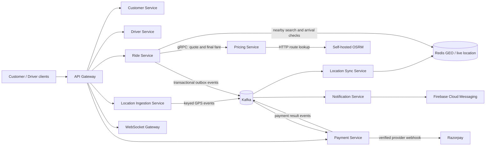

# GoOn — Ride-Hailing Microservices Platform

GoOn is a ride-hailing backend built as a set of Spring Boot services. It covers customer and driver access, quote-backed ride creation, driver matching, live location ingestion, ride lifecycle validation, payment processing, and notifications.

This repository is the **platform overview**. The services below are maintained in their own repositories.

> **Status:** portfolio and engineering project. The checked-in service configuration is primarily local-development configuration; provide real secrets and production infrastructure settings through environment variables before deployment.

## Service repositories

| Service | Responsibility | Repository |
|---|---|---|
| API Gateway | HTTP entry point, route dispatch, OAuth2 service-token handling | [Api-Gateway-Service](https://github.com/shashank35i/Api-Gateway-Service) |
| Customer Service | Customer registration, login, and customer identity | [Customer-Service](https://github.com/shashank35i/Customer-Service) |
| Driver Service | Driver-facing APIs and offer actions | [Driver-Service](https://github.com/shashank35i/Driver-Service) |
| Ride Service | Ride creation, matching, assignment, lifecycle, and ride outbox | [Ride-Service](https://github.com/shashank35i/Ride-Service) |
| Pricing Service | OSRM-backed route distance, fare quote, and final-fare gRPC API | [Pricing-Service](https://github.com/shashank35i/Pricing-Service) |
| Location Ingestion Service | Validates and asynchronously publishes driver GPS updates | [location-ingestion-service](https://github.com/shashank35i/location-ingestion-service) |
| Location Sync Service | Consumes location events and updates Redis geospatial state | [location-sync-service](https://github.com/shashank35i/location-sync-service) |
| Notification Service | Ride and payment notifications, including Firebase Cloud Messaging | [Notification-Service](https://github.com/shashank35i/Notification-Service) |
| Payment Service | Razorpay checkout integration, webhook verification, payment state, and payment outbox | [Payment-Service](https://github.com/shashank35i/Payment-Service) |
| WebSocket Gateway | WebSocket connection entry point for live updates | [ws-gateway-service](https://github.com/shashank35i/ws-gateway-service) |

## Architecture



Ride creation and state changes persist business data and an outbox event together in MySQL. Background publishers send those events to Kafka; consumers update their own state and use processed-event records where implemented to make message replay safe.

## Engineering details

### Self-hosted routing and fare quotes

Pricing Service uses the configured OSRM base URL `http://localhost:5000` (`app.osrm.url` in `pricing-service/src/main/resources/application.yaml`). It requests OSRM's driving route for pickup and drop-off coordinates and calculates the distance-based estimate from the returned route distance. The application is configured to use the local OSRM server; it does not need the public OSRM demo server.

For a local OSRM instance, provide an OpenStreetMap `.osm.pbf` extract that covers the locations you test. The map extract and generated routing data are not included in this repository. The following is the OSRM project's Docker-based MLD workflow; substitute your local extract filename and pin an OSRM image version for repeatable setups:

```bash
mkdir -p osrm-data
# Put a suitable local extract at osrm-data/region.osm.pbf
export OSRM_IMAGE=ghcr.io/project-osrm/osrm-backend:PINNED_VERSION
docker run --rm -t -v "$PWD/osrm-data:/data" "$OSRM_IMAGE" \
  osrm-extract -p /opt/car.lua /data/region.osm.pbf
docker run --rm -t -v "$PWD/osrm-data:/data" "$OSRM_IMAGE" \
  osrm-partition /data/region.osrm
docker run --rm -t -v "$PWD/osrm-data:/data" "$OSRM_IMAGE" \
  osrm-customize /data/region.osrm
docker run --rm -it -p 5000:5000 -v "$PWD/osrm-data:/data" "$OSRM_IMAGE" \
  osrm-routed --algorithm mld /data/region.osrm
```

Then set Pricing Service's `app.osrm.url` to `http://localhost:5000` (or the reachable OSRM host from the service's network namespace). The MLD steps follow the [official OSRM backend instructions](https://github.com/Project-OSRM/osrm-backend#using-docker).

### Location matching and arrival validation

- **Finding nearby drivers:** Ride Service queries Redis GEO by vehicle type and searches up to 5 km from the pickup, sorting nearest first. It skips drivers excluded earlier in matching. This is a Redis geospatial radius query, not a per-driver Haversine scan.
- **Verifying driver arrival:** Ride Lifecycle checks that the driver is assigned, requires a recent GPS heartbeat (no older than 15 seconds, with a small future-clock allowance), reads that driver's ride-specific Redis position, then computes great-circle distance with the Haversine formula. The driver can mark arrival only within 100 metres of pickup.
- **Starting a ride:** only a `DRIVER_ARRIVED` ride can start; the start OTP is checked and attempts are capped at five.

These checks are in `RideLifecycleService` in the [Ride Service source](https://github.com/shashank35i/Ride-Service/blob/main/src/main/java/com/goon/rideservice/service/RideLifecycleService.java). Nearby search is in [`NearbyDriverService`](https://github.com/shashank35i/Ride-Service/blob/main/src/main/java/com/goon/rideservice/service/NearbyDriverService.java).

### Concurrency and correctness

- **Request idempotency:** ride creation accepts an `Idempotency-Key`; the database has a customer/key uniqueness constraint, and matching retries are recovered using the stored request hash.
- **One active ride per customer:** `customer_active_rides` uses `customer_id BINARY(16)` as its primary key and a unique `ride_id`. The claim is inserted in the same database transaction as the ride and `RIDE_REQUESTED` outbox row. A concurrent request with another key loses the atomic claim and receives HTTP 409. End and cancellation release the claim.
- **One active ride per driver:** `driver_assignments` uses database uniqueness to arbitrate competing ride accepts.
- **Transactional outbox:** a ride state change and its event are committed together, preventing a committed ride from silently missing its corresponding event.
- **Payment webhooks:** Payment Service verifies Razorpay webhook signatures and tracks processed webhooks before applying payment state transitions.

## Engineering evidence

These are measured local validation results, not production SLAs. The evidence and test plans are retained in the local `validation/` workspace. The artifact paths below are local workspace paths; they will not resolve on GitHub unless that evidence bundle is added to this overview repository.

| Area | Recorded result | Scope / caveat |
|---|---|---|
| Customer double-booking race | **PASS:** two synchronized requests for one customer, with different idempotency keys and the same signed quote, produced one HTTP 201 and one HTTP 409. SQL showed one ride, one `RIDE_REQUESTED` outbox row, and one active-customer claim. | One two-request JMeter race plus a service-level concurrency test. Local artifact: `validation/customer-active-rides-20261028/customer-active-race-jmeter2/evidence.json`. |
| Competing accepts for one driver | **PASS:** 10 nearby ride pairs with simultaneous accepts produced exactly one successful accept per pair; 10 HTTP 200 and 10 HTTP 409. | Ten pairs on one local test environment. Local artifact: `validation/six-tests-20261028-230517-c36f78/test2-evidence.json`. |
| Same-key ride idempotency | **PASS:** 200 synchronized requests with the same customer, signed quote, and idempotency key returned 200 HTTP 201 responses, with one ride and one `RIDE_REQUESTED` outbox row. | One local 200-thread run; p95 was 2,188 ms in that run. Local artifact: `validation/six-tests-20261028-224222-930aba/test3-evidence.json`. |
| Location ingestion | **PASS:** at 500 threads for 60 seconds using 20 driver IDs, JMeter recorded 12,801 HTTP 202 responses, 0% errors, 221.33 req/s, p95 1,212 ms. Kafka lag was recorded as 0 after the run in the same evidence bundle. | Local single-host result; CPU peaked at 100%, so this is not a production capacity claim. Local artifact: `validation/six-tests-20261028-230049-e067a3/test6-multikey-evidence.json`. |
| Outbox crash/restart and replay | **PARTIAL / FAIL:** of 200 attempted create requests while Ride Service was killed mid-run, 194 returned HTTP 201 and 6 returned HTTP 500. All 194 acknowledged rides had outbox rows and were published; same-event replay did not create a second offer. | The consistency and deduplication checks passed for acknowledged events, but the run did not meet an all-success request criterion. Local artifact: `validation/six-tests-20261028-230656-ca629e/test5-complete-evidence.json`. |
| Deadlock demonstration | **PASS — database mechanism only:** two deliberately opposing MySQL row-lock sequences produced error 1213 and an InnoDB deadlock capture. | Demonstrates InnoDB's deadlock detection, not that an application endpoint reproduced the deadlock. Local artifact: `validation/six-tests-20261028-225446-7447fe/test4-db-level-evidence.json`. |

See [`validation/results.md`](validation/results.md) for the complete test notes, environment, and limitations. Results are from local development runs and should be reproduced against a clean environment before being presented as general performance guarantees.

## Technology

- Java 21, Spring Boot 4.1.1, Spring Security / OAuth2 Resource Server
- Spring MVC and gRPC between ride and pricing workflows
- MySQL for transactional service state and constraints
- Kafka for asynchronous events and location ingestion
- Redis GEO and sorted sets for live driver position and availability
- OSRM with locally hosted OpenStreetMap routing data
- Razorpay test-mode integration and Firebase Cloud Messaging
- Apache JMeter for concurrent HTTP/load validation

The technology versions above come from the current service POMs and recorded local validation. Kafka, Redis, MySQL, and the external integrations must be configured separately for a working environment.

## Local development

Each service repository is an independent Maven/Spring Boot application. There is currently no root Maven aggregator or one-command deployment file in this overview repository. Start the backing services first (MySQL schemas, Kafka, Redis, Keycloak, local OSRM, and Firebase/Razorpay test configuration as required), configure secrets through environment variables, then start the service modules individually.

The local application ports currently configured in the service repositories are:

| Component | Port |
|---|---:|
| API Gateway | 8087 |
| Customer Service | 8088 |
| Driver Service | 8084 |
| Ride Service | 8083 |
| Pricing Service HTTP / gRPC | 8086 / 9090 |
| Location Ingestion Service | 8080 |
| Location Sync Service | 8081 |
| Notification Service | 8085 |
| Payment Service | 8089 |
| WebSocket Gateway | 8082 |
| Local OSRM | 5000 |

Use each service's Maven wrapper, for example:

```bash
cd ride-service
./mvnw spring-boot:run
```

On Windows, use `mvnw.cmd` in place of `./mvnw`. Check each service's `application.yaml` and required environment variables before starting it. Do not commit real client secrets, signing keys, database passwords, Firebase credentials, or Razorpay credentials.

## Database migrations

SQL schema changes are kept under [`database/migrations`](database/migrations). Apply migrations to the matching service database before starting a service that depends on the new table or column. For example, [`2026-10-28-customer-active-rides.sql`](database/migrations/2026-10-28-customer-active-rides.sql) creates and backfills the active customer claim table.

## Validation and reproducibility

JMeter `.jmx` plans, SQL checks, captured results, and environment notes are stored under `validation/`. Run load tests in non-GUI mode and use fresh credentials/fixtures; never store live JWTs or provider secrets in a committed plan. The recorded reports include both successful checks and tests that exposed limitations.

## License

No license has been declared in this overview repository yet. Until one is added, do not assume the source is available for unrestricted reuse.
