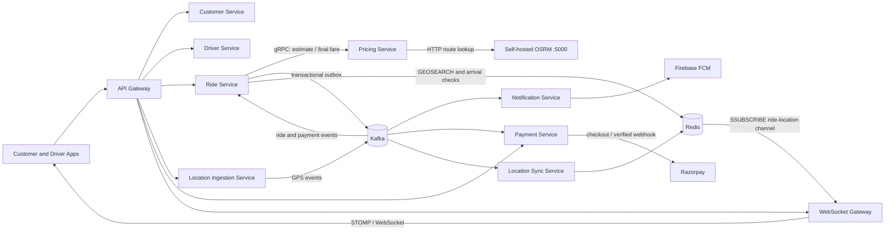
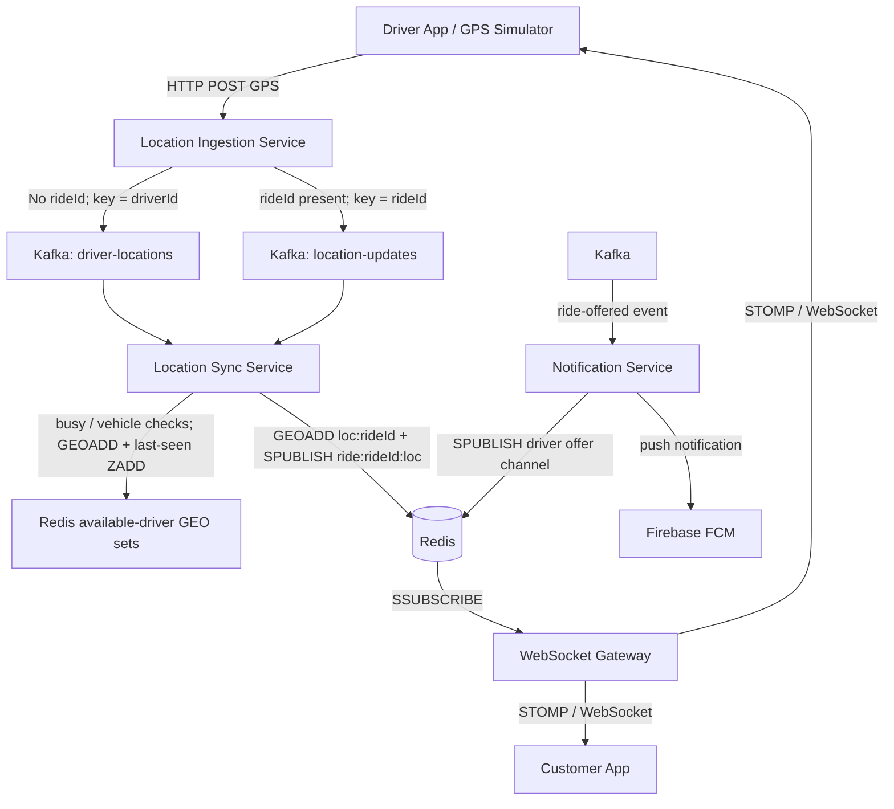
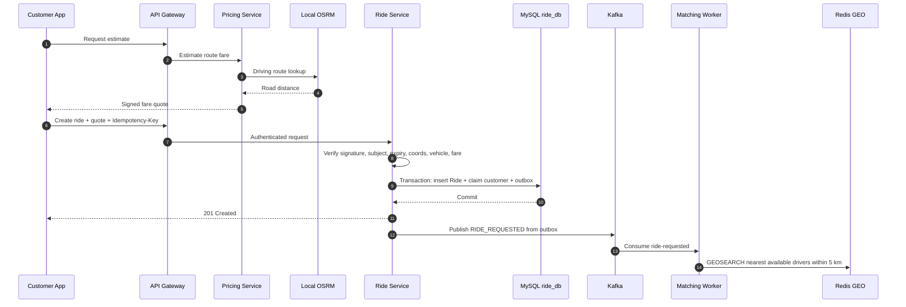
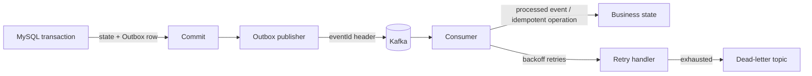
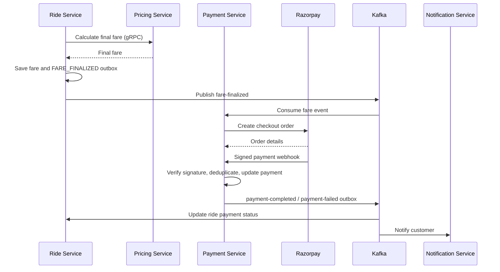

# GoOn — Ride-Hailing Microservices Platform

**A ride-hailing backend built around atomic bookings, event-driven GPS, route-aware pricing, and verified lifecycle transitions.**

GoOn consists of ten independently versioned Spring Boot services. This repository is the platform overview; the service implementations remain in their own repositories.

> **Status:** portfolio/local-development system. Measurements below are local validation results, not production SLAs. Dependencies and integrations require separate configuration.

## Engineering results at a glance

| Engineering problem | Design / measured outcome |
|---|---|
| Customer double-booking | Atomic `customer_active_rides` claim in the same transaction as `Ride` and `RIDE_REQUESTED` outbox: two simultaneous different-key requests yielded **1 HTTP 201 + 1 HTTP 409**, with one ride and one outbox row. |
| Competing ride accepts | Pessimistic Ride → RideOffer lock order and unique `driver_assignments` claim. Ten one-driver/two-ride races had one winner each; accept/decline races preserved one terminal action per ride. |
| Same-key retry | Customer + `Idempotency-Key` uniqueness and stored request hash; a 200-thread run returned **200 × HTTP 201**, with one ride and one outbox event. |
| UUID lookup failure | Diagnosed Hibernate/MySQL `BINARY(64)` versus 16-byte UUID binding mismatch. Corrected UUID storage to `BINARY(16)`; the later same-key retry run passed. |
| GPS ingestion | 100 / 250 / 500-thread JMeter runs returned **22,470 HTTP 202, 0% errors** total. At 500 threads: **221.33 req/s**, p95 **1,212 ms**; Kafka lag drained to zero after the test. |
| Outbox recovery | After forced Ride Service termination, 194 acknowledged rides had published outbox rows and replay created no second offer. Six in-flight requests returned HTTP 500, so this run is **partial/fail**, not all-success. |
| OAuth2 token burst | Keycloak logs went from 100 token-endpoint warnings in a 3-second cold burst to 2 around a focused retest. These are warning counts, not a direct token-fetch counter. |
| Redis/Lettuce publish debugging | A development run reported roughly 10× duplicate location broadcasts. The current path keeps `GEOADD` + `EXPIRE` in the pipeline and sends one typed Lettuce `SPUBLISH` afterward. The 10× figure was not retained as a controlled benchmark. |

The benchmark bundle contains portable JMeter plans, sanitized JTLs, result summaries, and SQL checks: [`benchmarks/RESULTS.md`](benchmarks/RESULTS.md).

## Service repositories

| Service | Responsibility | Repository |
|---|---|---|
| API Gateway | HTTP routing, JWT validation, internal OAuth2 client-credentials relay | [Api-Gateway-Service](https://github.com/shashank35i/Api-Gateway-Service) |
| Customer Service | Customer identity and login | [Customer-Service](https://github.com/shashank35i/Customer-Service) |
| Driver Service | Driver APIs and offer actions | [Driver-Service](https://github.com/shashank35i/Driver-Service) |
| Ride Service | Quotes, rides, matching, assignments, lifecycle, outbox | [Ride-Service](https://github.com/shashank35i/Ride-Service) |
| Pricing Service | Signed fare quotes and final fare; OSRM routing | [Pricing-Service](https://github.com/shashank35i/Pricing-Service) |
| Location Ingestion Service | HTTP GPS intake and Kafka publishing | [location-ingestion-service](https://github.com/shashank35i/location-ingestion-service) |
| Location Sync Service | Kafka consumers and Redis live-location state | [location-sync-service](https://github.com/shashank35i/location-sync-service) |
| Notification Service | Event-driven notifications, Redis Pub/Sub, Firebase push | [Notification-Service](https://github.com/shashank35i/Notification-Service) |
| Payment Service | Razorpay checkout, webhook validation, payment outbox | [Payment-Service](https://github.com/shashank35i/Payment-Service) |
| WebSocket Gateway | STOMP/WebSocket and live ride-location fan-out | [ws-gateway-service](https://github.com/shashank35i/ws-gateway-service) |

## Architecture



### Live GPS and notifications

Idle-driver availability and an active ride's location use separate Kafka topics and keys:



**Implementation boundary:** the current WebSocket subscriber forwards `ride:<rideId>:loc` location messages. Notification Service publishes offers to a separate Redis sharded channel and sends FCM; the WebSocket Gateway does not currently bridge that driver-offer channel. Local development uses Redis, not a verified Redis Cluster deployment. The code uses Redis sharded Pub/Sub commands (`SPUBLISH` / `SSUBSCRIBE`).

**Redis/Lettuce lesson:** an earlier implementation mixed raw `SPUBLISH` into Spring Data Redis's `executePipelined` callback with `GEOADD` and `EXPIRE`. The current implementation pipelines only the geospatial write and TTL, serializes the event as a string, and publishes once with `StatefulRedisConnection<String, String>.sync().spublish(...)`. The reported ≈10× duplicate fan-out is a development observation; the archived validation bundle has no controlled before/after measurement for that multiplier. See the current [location consumer implementation](https://github.com/shashank35i/location-sync-service/blob/main/src/main/java/com/goon/locationsyncservice/service/ConsumeLocationUpdates.java).

## Booking and lifecycle



Ride state moves through `REQUESTED → ASSIGNED → DRIVER_ARRIVED → STARTED → ENDED`; a customer may cancel before start. Each state change and its outbox event are stored atomically.

### Driver arrival: Haversine geofence

Ride Lifecycle verifies the assigned driver, rejects a missing or stale GPS heartbeat (older than 15 seconds), reads that driver's ride-specific Redis position, then calculates great-circle distance to pickup. Arrival is accepted only within 100 m. Nearby matching is different: Redis GEOSEARCH returns available drivers within 5 km, nearest first.

$$
a = \sin^2\left(\frac{\Delta\varphi}{2}\right)
  + \cos(\varphi_1)\cos(\varphi_2)
    \sin^2\left(\frac{\Delta\lambda}{2}\right)
$$

$$
d = 2R\operatorname{atan2}\left(\sqrt{a}, \sqrt{1-a}\right),
\qquad R \approx 6{,}371{,}000\text{ m}
$$

`φ` is latitude and `λ` longitude in radians. Arrival requires `d ≤ 100 m`, a fresh GPS update, and the correct driver-to-ride assignment. Starting requires the ride to be `DRIVER_ARRIVED` and a customer OTP; attempts are capped at five.

Source: [`RideLifecycleService`](https://github.com/shashank35i/Ride-Service/blob/main/src/main/java/com/goon/rideservice/service/RideLifecycleService.java) · [`NearbyDriverService`](https://github.com/shashank35i/Ride-Service/blob/main/src/main/java/com/goon/rideservice/service/NearbyDriverService.java)

## Concurrency and idempotency

$$
\forall d,\quad |\operatorname{ActiveRides}(d)| \leq 1
\qquad
\forall c,\quad |\operatorname{ActiveRides}(c)| \leq 1
\qquad
\forall r,\quad |\operatorname{AcceptedOffers}(r)| \leq 1
$$

- **One active ride per driver:** `driver_assignments` uses `driver_id` as its primary key and unique `ride_id`. An atomic insert lets only one competing accept claim the driver.
- **One active ride per customer:** `customer_active_rides` uses `customer_id BINARY(16)` as primary key and unique `ride_id BINARY(16)`. It is inserted in the same transaction as Ride and Outbox. A different-key concurrent booking returns HTTP 409; end/cancel releases the claim.
- **One accepted driver per ride:** accept locks Ride then RideOffer, validates their current state, claims the driver, and commits the assignment and event together.
- **Retry-safe create:** customer + idempotency key has a database uniqueness constraint. Matching payload hashes recover the existing ride; same key with changed request returns 409.
- **Signed quotes:** Ride Service verifies signature, customer subject, expiry, coordinates, vehicle type, currency, and fare before a new insert.

### UUID mapping bug

The first high-concurrency retry test returned HTTP 500 for duplicates even though SQL showed a single inserted ride. The cause was a Hibernate/MySQL UUID mapping mismatch: UUID columns were stored as `BINARY(64)` while UUID parameters were bound as 16 bytes, leaving padded values that recovery queries did not match reliably. UUID mappings and schema were corrected to `BINARY(16)`; the later 200-thread same-key run returned 200 HTTP 201 responses and still created exactly one ride and one `RIDE_REQUESTED` outbox row.

Migrations: [active customer claim](database/migrations/2026-10-28-customer-active-rides.sql) · [UUID binary-16 migration](database/migrations/2026-10-28-ride-uuid-binary16.sql)

## Outbox, retries, and service tokens



Ride matching uses manual immediate acknowledgments, bounded retries with backoff, and a dead-letter topic. Consumers use event IDs and idempotent processing where implemented. The target is **one business effect under replay**, not universal exactly-once delivery.

Internal HTTP/gRPC calls use Keycloak client-credentials registrations. Gateway authorization uses a fixed service principal and serializes token cache misses per client registration; internal token providers cache by registration ID/scope set with single-flight refresh. Caches are in process, so each service instance has its own cache. In a focused local diagnostic, Keycloak warning logs fell from 100 over three seconds to two around the retest; this was a warning count, not a token-fetch counter. Details: [token diagnostic](benchmarks/evidence/token-cache-diagnostic.json).

## Fare and payments

Pricing Service calls local OSRM at `http://localhost:5000` for actual road distance; no public OSRM demo server is used by the configured application. The service signs the quote Ride Service verifies. Final fare adds waiting charges after the first 120 free seconds.



## Load-test results

JMeter 5.6.3 measured these GPS runs on one developer machine:

| Threads | Samples | RPS | p50 | p95 | p99 | Errors |
|---:|---:|---:|---:|---:|---:|---:|
| 100 | 2,797 | 48.62 | 6 ms | 23 ms | 89 ms | 0% |
| 250 | 6,872 | 118.75 | 8 ms | 249 ms | 600 ms | 0% |
| 500 | 12,801 | 221.33 | 40 ms | 1,212 ms | 1,637 ms | 0% |

At 500 threads, 20 driver IDs were used, events reached all three partitions, CPU peaked at 100%, and RAM peaked at 16,073.5 MiB. Lag was 1,006 immediately after the run and 0 after the recorded drain wait. This indicates the local consumer group caught up after traffic stopped; it does not establish production capacity.

An earlier single-driver comparison recorded immediate lag of **8,817 before** and **3,049 after** partition expansion plus additional consumers; the later snapshot drained to zero after 30 seconds. That is a 65.4% reduction between separate runs, not a controlled causal benchmark. With a single driver key, events remain ordered on one partition and cannot be split across consumers. [Lag evidence](benchmarks/evidence/single-key-lag-comparison.json)

See [full test setups, caveats, plans, sanitized JTLs, and JSON results](benchmarks/RESULTS.md).

## Self-hosted OSRM

Pricing Service config sets `app.osrm.url: http://localhost:5000`. Supply an OpenStreetMap `.osm.pbf` extract for your test area; map and processed graph files are not committed. Example MLD setup following the [official OSRM Docker workflow](https://github.com/Project-OSRM/osrm-backend#using-docker) (pin an image tag for repeatability):

```bash
mkdir -p osrm-data
# Place an extract at osrm-data/region.osm.pbf
export OSRM_IMAGE=ghcr.io/project-osrm/osrm-backend:PINNED_VERSION
docker run --rm -t -v "$PWD/osrm-data:/data" "$OSRM_IMAGE" osrm-extract -p /opt/car.lua /data/region.osm.pbf
docker run --rm -t -v "$PWD/osrm-data:/data" "$OSRM_IMAGE" osrm-partition /data/region.osrm
docker run --rm -t -v "$PWD/osrm-data:/data" "$OSRM_IMAGE" osrm-customize /data/region.osrm
docker run --rm -it -p 5000:5000 -v "$PWD/osrm-data:/data" "$OSRM_IMAGE" osrm-routed --algorithm mld /data/region.osrm
```

Configure Pricing Service with the OSRM address reachable from its own network namespace. The app is configured for the local endpoint, not the public demo endpoint.

## Local development

There is no root Maven aggregator or one-command stack launcher yet. Current local ports:

| Component | Port |
|---|---:|
| API Gateway | 8087 |
| Customer / Driver / Ride Services | 8088 / 8084 / 8083 |
| Pricing HTTP / gRPC | 8086 / 9090 |
| Location Ingestion / Location Sync | 8080 / 8081 |
| Notification / Payment Services | 8085 / 8089 |
| WebSocket Gateway | 8082 |
| Local OSRM | 5000 |

Start MySQL, Kafka, Redis, Keycloak, local OSRM, and any required Firebase / Razorpay test configuration first. Each service is its own Maven project:

```bash
cd ride-service
./mvnw spring-boot:run
```

On Windows, run `mvnw.cmd`. Apply the SQL migrations to the matching service database. POMs target Java 21; recorded validation ran on JDK 23.0.1. Supply secrets via environment variables or local untracked configuration—never commit signing keys, client secrets, database passwords, Firebase credentials, Razorpay keys, JWTs, OTPs, or device tokens.

## Validation bundle

- [Benchmark summary](benchmarks/RESULTS.md)
- [Portable JMeter plans](benchmarks/plans/)
- [Sanitized JTL results](benchmarks/results/)
- [Machine-readable evidence](benchmarks/evidence/)
- [SQL invariant checks](benchmarks/sql/verify-results.sql)

Fixture templates include headers only. Create fresh test identities and quote data locally before running a plan.

## License

No license is declared yet. Do not assume unrestricted reuse until one is added.
