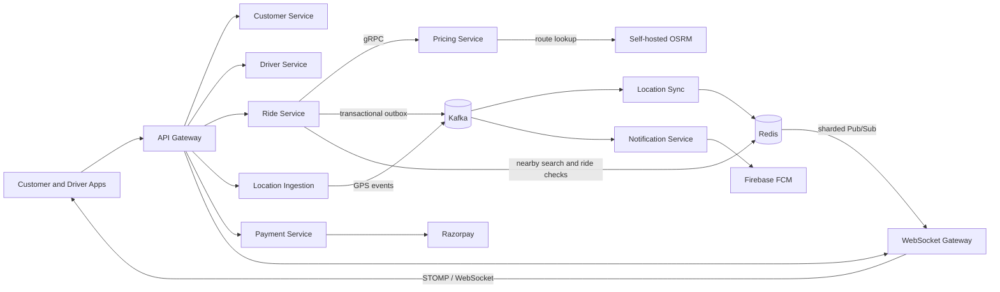
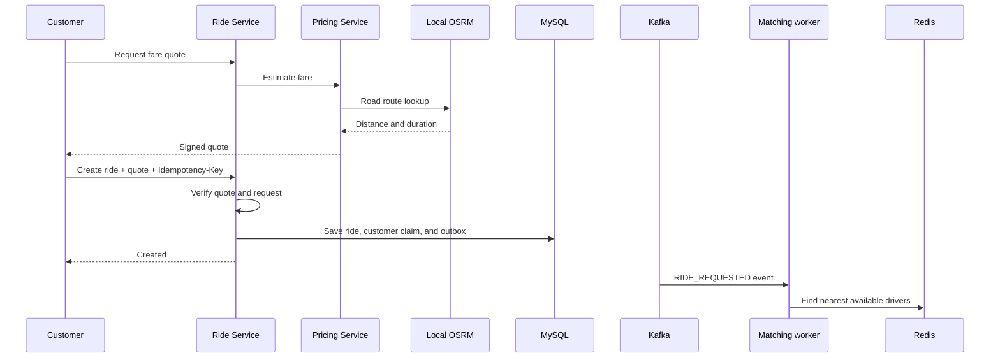

# GoOn — Ride-Hailing Microservices Platform

GoOn is a Spring Boot microservices project for ride booking, driver matching, live location, pricing, notifications, and payments.

## Services

| Service | Role | Repository |
|---|---|---|
| API Gateway | Routing and request authentication | [Api-Gateway-Service](https://github.com/shashank35i/Api-Gateway-Service) |
| Customer Service | Customer accounts | [Customer-Service](https://github.com/shashank35i/Customer-Service) |
| Driver Service | Driver APIs and ride offers | [Driver-Service](https://github.com/shashank35i/Driver-Service) |
| Ride Service | Booking, matching, ride lifecycle | [Ride-Service](https://github.com/shashank35i/Ride-Service) |
| Pricing Service | Signed quotes and final fares | [Pricing-Service](https://github.com/shashank35i/Pricing-Service) |
| Location Ingestion | GPS HTTP endpoint and Kafka producer | [location-ingestion-service](https://github.com/shashank35i/location-ingestion-service) |
| Location Sync | Kafka consumers and Redis location state | [location-sync-service](https://github.com/shashank35i/location-sync-service) |
| Notification Service | Redis notifications and Firebase push | [Notification-Service](https://github.com/shashank35i/Notification-Service) |
| Payment Service | Razorpay checkout and webhook handling | [Payment-Service](https://github.com/shashank35i/Payment-Service) |
| WebSocket Gateway | Live ride updates over STOMP/WebSocket | [ws-gateway-service](https://github.com/shashank35i/ws-gateway-service) |

## Architecture

[High-level design (HLD) in Excalidraw](https://excalidraw.com/#json=LZ0dhA7Fv0mq9qvbU2c6d,oJ580YLlsaPw_cdPOC5HAg)



### GPS and driver matching

Driver GPS requests go through Location Ingestion into Kafka. Idle-driver updates use the `driver-locations` topic keyed by driver ID; active-ride updates use `location-updates` keyed by ride ID. Location Sync updates Redis GEO state. Ride Service searches available drivers within 5 km, nearest first. Ride locations are published through Redis sharded Pub/Sub and forwarded to clients by the WebSocket Gateway.

### Ride lifecycle



Ride states: `REQUESTED → ASSIGNED → DRIVER_ARRIVED → STARTED → ENDED`. Ride changes and their outbox events are committed together. Cancellation is supported before ride start.

## Engineering highlights

- **Concurrent booking protection:** database claims enforce one active ride per customer and per driver. A 2-request customer race produced one `201` and one `409`; a 10-pair driver race produced one successful accept per pair.
- **Idempotent ride creation:** a 200-thread same-key JMeter run returned 200 successful responses while creating one ride and one `RIDE_REQUESTED` event.
- **UUID mapping fix:** corrected a MySQL/Hibernate `BINARY(64)` versus 16-byte UUID mismatch by standardizing UUID storage on `BINARY(16)`.
- **Transactional outbox:** ride state and events are persisted together, then published to Kafka. Consumers use event IDs and idempotent processing where implemented.
- **GPS load run:** with 20 driver IDs and 500 JMeter threads, measured 221.33 requests/sec, p95 1,212 ms, and 0% errors. The local Kafka lag drained to zero after traffic stopped.
- **Outbox recovery run:** 194 acknowledged ride creates were published and replay did not create a second offer. Six in-flight requests returned 500 during forced service termination, so the run was partial.

Detailed JMeter plans, sanitized results, and SQL checks are in [benchmarks](benchmarks/RESULTS.md).

## Driver arrival check

Ride Lifecycle verifies the assigned driver and requires a GPS update no older than 15 seconds. It reads the ride-specific Redis position and calculates great-circle distance to pickup. Arrival is accepted within 100 m. Starting a ride also requires the customer OTP.

$$
a = \sin^2(\Delta\varphi / 2) + \cos(\varphi_1)\cos(\varphi_2)\sin^2(\Delta\lambda / 2)
$$

$$
d = 2R \times atan2(\sqrt{a}, \sqrt{1-a}), \qquad R \approx 6,371,000\text{ m}
$$

Here, `φ` and `λ` are latitude and longitude in radians. See [RideLifecycleService](https://github.com/shashank35i/Ride-Service/blob/main/src/main/java/com/goon/rideservice/service/RideLifecycleService.java) and [NearbyDriverService](https://github.com/shashank35i/Ride-Service/blob/main/src/main/java/com/goon/rideservice/service/NearbyDriverService.java).

## Pricing and payments

Pricing Service uses the locally hosted OSRM endpoint configured at `http://localhost:5000`; it signs fare quotes that Ride Service validates. After a ride ends, Ride Service requests the final fare, saves it with a `FARE_FINALIZED` outbox event, and Payment Service creates a Razorpay checkout. Payment status changes only after webhook signature verification.

## Local development

Services are separate Maven projects and target Java 21. Start MySQL, Kafka, Redis, Keycloak, and local OSRM, then run an individual service, for example:

```bash
cd ride-service
./mvnw spring-boot:run
```

On Windows, use `mvnw.cmd`. Pricing Service expects OSRM on port `5000`.

| Component | Port |
|---|---:|
| API Gateway | 8087 |
| Customer / Driver / Ride | 8088 / 8084 / 8083 |
| Pricing HTTP / gRPC | 8086 / 9090 |
| Location Ingestion / Sync | 8080 / 8081 |
| Notification / Payment | 8085 / 8089 |
| WebSocket Gateway | 8082 |
| OSRM | 5000 |
